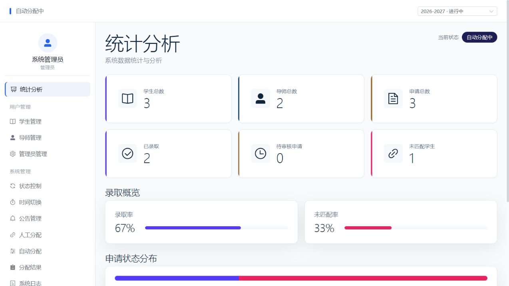
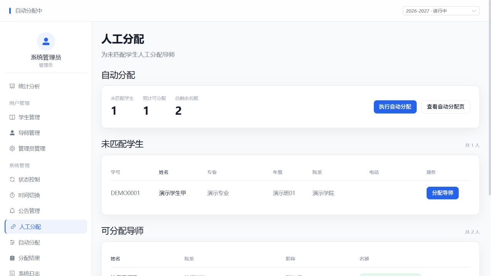
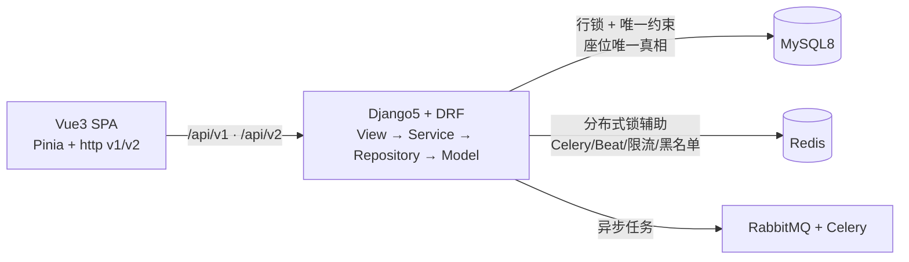
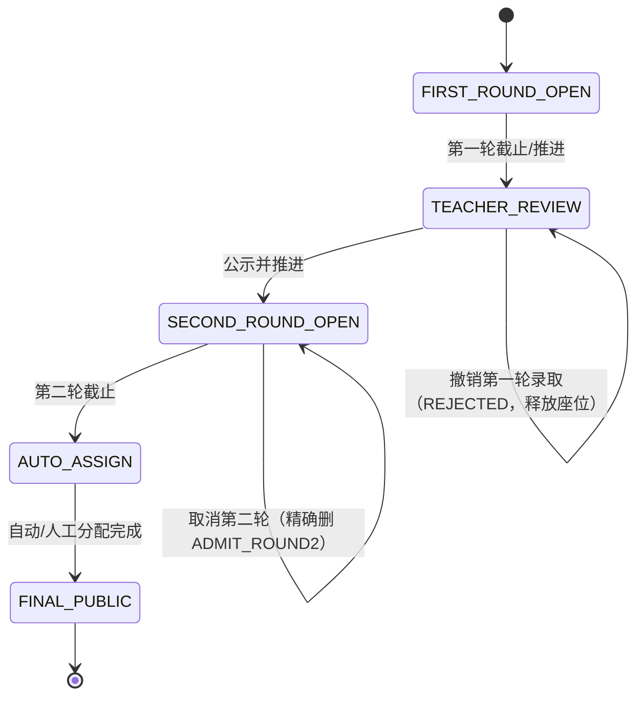

# 学生选导师系统（Student–Mentor Selection）

> 全栈导师双选平台：Vue 3 + TypeScript + Vite 前端，Django 5 + DRF 后端，MySQL 8 主库，Redis 负责锁/后台基础设施，JWT（SimpleJWT，支持轮换+黑名单）认证。
> 许可证：MIT，Copyright (c) 2026 NyaTato。依赖各自许可证独立适用，见 `docs/third-party-notices.md`。

## 一句话业务

学生（第一轮填报，可修改同一申请）→ 导师审核（通过/拒绝；第一轮已通过可在 `TEACHER_REVIEW` 阶段撤销）→ 第二轮（仅未录取学生，先到先得 FCFS，满额/无名额拒绝，可取消释放名额）→ 管理员人工分配 / 自动分配（预览→执行→撤销）→ 结果公示。系统状态机推进/回滚，全程审计日志。

- 角色：学生（仅本人 + 有名额汇总可见）、导师（仅本人名下申请/录取 + 相关学生）、管理员（全量 + 导入/日志/分配/状态）。
- 名额语义（有意收紧）：未配置名额 = 拒绝录取（`QUOTA_NOT_FOUND=40003`），而不是无限录取。
- 取消第二轮只按 `application_id` 精确删除 `ADMIT_ROUND2`，不按学生全删；管理员人工分配（`MANUAL`）不受学生取消影响。

## 仓库结构

| 路径 | 说明 |
|---|---|
| `mentor-select-backend/` | Django + DRF 后端（`apps/*` 业务，`api/*` v2 档案适配，`lib/*` 档案服务/仓储适配） |
| `mentor-select-frontend/` | Vue 3 + TS + Vite 前端（`src/api/http.ts` 双实例：v1/v2，`data-loader.ts` 读，`write-api.ts` 写） |
| `docs/ARCHITECTURE.md` | 架构（本文档的详细版，Mermaid + 分层 + 锁顺序） |
| `docs/API.md` | 接口总览（v2 状态表 + 错误码 + 时间/ID 契约） |
| `docs/testing.md` | 测试说明（以本文“已验证结果”为准，不虚构 E2E） |
| `docs/development.md` | 本地开发/演示/环境变量说明 |
| `docs/resume-project.md` | 简历项目描述（只写已验证事实） |
| `docs/interview-notes.md` | 面试问答要点（并发/缓存/鉴权/状态机） |
| `docs/third-party-notices.md` | 第三方依赖许可证清单（按本地包元数据整理） |
| `.env.example` | 根级安全示例（开发本地端点 + 空密码 + 占位密钥，生产示例明确不可用） |

历史内部文档/会议纪要/旧性能报告不在公开链接中引用。以下截图取自隔离 SQLite 演示库，角色、学生和导师均为虚构数据：




## 架构速览





- 权威数据源：canonical `apps` 模型（`User` + `StudentProfile`/`TeacherProfile`/`AdminProfile`，档案主键 = `user_id`；`Application` / `Admission` / `TeacherQuota` / `SystemState` 等业务模型）。
- 分层边界：View 只做请求/响应转换；Service 持有事务与业务规则（含固定锁顺序）；Repository 只做查询/加锁读；Model 定义约束。`lib/service + lib/db_manager` 是 v2 档案路由的 canonical ORM 适配器，不是第二套业务。
- 并发锁顺序（任何路径不得颠倒）：学生行 → 申请行 → 导师名额行 → 录取当前读计数（`select_for_update` 物化，绕过 REPEATABLE READ 快照）。Redis 分布式锁只是辅助降冲突，正确性完全由 DB 行锁 + `uk_year_student` 等唯一约束保证。
- Redis 说明：Redis 用于锁/后台基础设施；`apps/common/cache_service.py` 的业务读缓存包装器当前未被生产业务 Service 调用，因此不声称“已部署 Redis 读缓存一致性保证”。
- 旧双表库：旧实现曾写 legacy `student/teacher/admin/user` 表并手工同步档案；现已统一到 canonical 单写，**不提供旧生产库自动迁移**，历史数据需按 `user_id` 离线对账（见 `docs/development.md`）。

## API v2 状态（已核对路由源码）

| 组 | 范围 | 状态 |
|---|---|---|
| A 已完成 v2（重建功能） | `api/urls.py` 档案 CRUD：`users/*`、`students/*`、`teachers/*`、`admins/*`（canonical ORM 重写，形状保持，权限收紧） | v2 正式入口 |
| B 仍只 v1 | `imports/*`（上传/模板/任务/日志）、`logs/*`（操作/登录日志）；`auth/*` 按后端契约保留 v1 | 前端经 v1 调用 |
| C 路由复用（非重建） | `applications/`、`assignments/（admissions/auto-logs/manual-assign/auto-assign/*）`、`announcements/`、`system/`、`statistics/`、`academic-years/`、`teachers/(profiles/directory/quotas)`：`api/urls.py（/api/v2/…）` 与 `config/api_urls.py（/api/v1/…）` include 同一套 `apps.*.urls`/View，因此 v1/v2 读到同一份业务状态；`POST applications/{id}/revoke-approval/` 在 v1/v2 同时可用（同一 router 别名） | 路由复用，不叫“重写 v2” |
| D 旧归档 | `model/entity/*.py（managed=False）`、`lib/db_manager/base_db.py` 等当前无业务代码引用；原项目的 `model/sql/*.sql` 仅留在私有原仓库，公开副本不包含旧 SQL | 不参与运行 |

详情（逐端点表、权限、分页 `{"list","total","page","page_size","total_pages"}`）见 `docs/API.md`。

- 错误格式：统一 `{code, message, data}`。v2 档案层小码（`0/1001–1005/10001`，见 `mentor-select-backend/constant/error_code.py`）；v1 业务层分段码（`1xxxx–11xxxx`，见 `docs/API.md`）。
- 时间：`Asia/Shanghai`，`USE_TZ=True`，DRF 默认 ISO-8601；非法查询参数统一 400（不再 500）。
- ID 契约：canonical 档案主键为 `user_id`；v2 响应 `id == user_id`（路径 `student_id/teacher_id/admin_id` 即 `user_id`）。旧 legacy 自增 `id` 与新语义不可混用，缓存旧 ID 的前端需刷新。

## 全新复现（Windows 友好）

前置：Python 3.12+、Node 20+、MySQL 8（仅生产/回归需要；演示不需要）。

```bat
:: 后端（精确复现：已验证的冻结依赖）
cd mentor-select-backend
python -m venv venv
venv\Scripts\activate
python -m pip install -r requirements-tested.txt
python manage.py migrate
python manage.py runserver 127.0.0.1:8000

:: 后端（灵活开发替代，仍受 constraints-security.txt 下限约束）
python -m pip install -r requirements-dev.txt

:: 前端
cd mentor-select-frontend
npm ci
npm run dev
:: 类型检查+构建： npm run build
```

以上普通开发模式需在后端 `.env` 配置本机 MySQL、Redis、RabbitMQ；只体验核心流程可用下述 SQLite 隔离演示，不需配置外部服务。

环境变量：复制各目录 `.env.example` 为 `.env` 后填入本机值；生产 `SECRET_KEY` 须 ≥50 随机字符且不含占位标记，`JWT_SIGNING_KEY` 显式设置时 ≥32 位（见 `config/settings/key_guard.py`，`prod.py` 启动即校验）。根 `.env.example` 只含开发本地端点与空密码/占位密钥，生产示例明确不可直接使用。

## 隔离演示（故意与生产隔离）

```bat
cd mentor-select-backend
mkdir work
python manage.py migrate --settings=config.settings.demo
python manage.py seed_demo --settings=config.settings.demo [--password 自设密码]
python manage.py runserver 127.0.0.1:8000 --settings=config.settings.demo
```

- 演示库固定为 `<backend>/work/demo.sqlite3`，`seed_demo` 双重守卫（`DEMO_MODE` + SQLite 路径复核），非 demo settings 拒绝写入。
- 账号按 `update_or_create` 幂等播种：`demo_admin`、`demo_teacher/demo_teacher2`、`demo_student/demo_student2/demo_student3`；学年 `2026-2027`（ACTIVE）、两位导师各名额 2、一则已发布公告；不播种申请/录取，留给浏览器完整演练。
- 密码：`--password` 或 `SMSP_DEMO_PASSWORD`，均未提供则按进程随机 `secrets.token_urlsafe(16)`，只打印一次，不写文件、无硬编码密码。文档中不提供固定演示密码。
- 故意降级：原生 Redis 指向不可用端口（`127.0.0.1:1/DB15`），需要真 Redis 的自动推进/自动分配在演示中不可用；`DEBUG=False`；JWT 签名密钥按进程随机，与生产密钥体系完全隔离。请勿以 `0.0.0.0` 对外暴露演示。

## 已验证结果（只写证据内事实，2026-10-16）

| 项目 | 证据内结论 |
|---|---|
| 后端 SQLite 全量（补丁验证运行时 Django 5.2.18 / DRF 3.18.3 / PyJWT 2.15.1 / idna 3.20 / sqlparse 0.6.0 / urllib3 2.8.0，82 包冻结 `requirements-tested.txt`） | 808 passed、6 MySQL-only skipped（814 collected，9.35s）；`makemigrations --check` 无变更 |
| 后端 MySQL 全量（全新一次性 `test_smsp_*` 库，只建/删该测试库，不动业务库） | 814 passed（含 6 个严格并发测试，28.24s） |
| 依赖安全 | Python `pip-audit` 补丁闭包 0 已知漏洞（初审 82 包闭包 37 advisories/6 包，已提 minima + `constraints-security.txt` 纠正）；前端 `npm audit --omit=dev` 旧 6 high 条目在 semver 内修复，`npm ci --ignore-scripts` 后审计 0 vulnerabilities |
| 前端构建 | `npm run build`（vue-tsc + Vite）2026-10-16 最终重跑通过；大范围迁移任务曾超限，所留代码经定点修复和回归验收 |
| 浏览器/演示流程 | 隔离虚构演示库完成三角色浏览器操作：第一轮提交与修改、导师拒绝/通过/撤销、第二轮申请/取消/重申、管理员人工分配及刷新后持久化；未验证真实 Redis 环境中的浏览器流程 |

MySQL 回归须显式 opt-in：`SMSP_ALLOW_ISOLATED_MYSQL_TESTS=1` + `SMSP_TEST_DATABASE=test_smsp_<8–40位小写数字下划线>`（见 `config/settings/test_mysql.py`），凭据只放本机环境/未跟踪 `.env`，报告中不记录。SQLite 下并发文件显式 skip，不声称验证行锁。

## 许可

MIT License，Copyright (c) 2026 NyaTato，用户拥有全部项目工作成果。第三方依赖许可证各自独立适用，不归属用户（见 `docs/third-party-notices.md`）。
