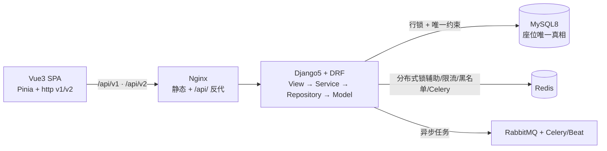
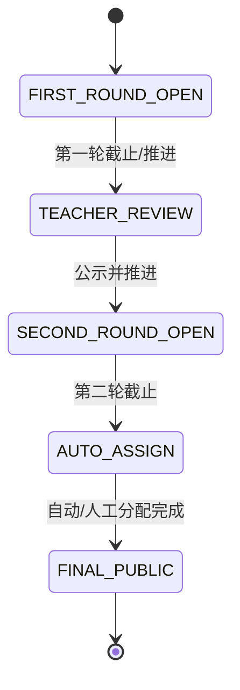

# 学生选导师系统 — 架构（v2 现状，以源码与已验证证据为准）

> 本文件为架构权威简版。历史长文细节以本文件纠正为准；接口逐端点见 `docs/API.md`，
> 测试证据见 `docs/testing.md`，本地运行见 `docs/development.md`。

## 1. 技术栈（已核对源码/冻结依赖）

- 前端：Vue 3（Composition API + `<script setup>`）、TypeScript（strict）、Vite、Pinia（含跨标签页同步）、Vue Router 4、Element Plus、UnoCSS、Axios。`src/api/http.ts` 提供 v1（`/api/v1`）与 v2（`/api/v2`）双实例；`data-loader.ts` 负责读，`write-api.ts` 负责写。
- 后端：Python 3.12+、Django 5.x、DRF；认证 `djangorestframework-simplejwt`（Access 30min / Refresh 7天可配，`ROTATE_REFRESH_TOKENS + BLACKLIST_AFTER_ROTATION` 已启用，刷新经 `TokenRefreshSerializer` 真轮换）；数据库 MySQL 8（主库）；Redis 负责锁/后台基础设施；RabbitMQ + Celery/Beat 负责异步与定时。
- 精确复现依赖：`mentor-select-backend/requirements-tested.txt`（Django 5.2.18 / DRF 3.18.3 / PyJWT 2.15.1 / idna 3.20 / sqlparse 0.6.0 / urllib3 2.8.0，82 包冻结，`pip-audit` 0 已知漏洞）；开发灵活替代 `requirements-dev.txt`（仍受 `constraints-security.txt` 下限约束）。

## 2. 总体架构

## 3. 业务工作流（双轮 + 分配）

- 第一轮：学生提交，可修改同一申请（同轮不新增行）；导师/管理员审核（approve/reject）；已 REJECTED 的第一轮不可再提交。
- 撤销第一轮录取：`POST applications/{id}/revoke-approval/`（申请 ID），仅第一轮 + APPROVED + 仍处 `TEACHER_REVIEW`，精确删 `ADMIT_ROUND1` 一行并置 REJECTED，学生恢复第二轮资格。v1/v2 同一 router 别名同时可用。
- 第二轮：仅未录取学生，先到先得（FCFS）；未配置名额或已满拒绝（`QUOTA_NOT_FOUND=40003` / `ADMISSION_QUOTA_FULL`）；取消只按 `application_id` 精确删 `ADMIT_ROUND2`，人工（`MANUAL`）分配不受影响。
- 管理员：`manual-assign/`（201，持久化）、自动分配预览/执行/撤销（`auto-assign/preview|run|revoke/`，仅管理员）。

角色：学生仅本人；导师仅本人名下申请/录取 + 有真实申请或录取关系的学生（档案整行级裁剪，`total` 与行同过滤；无关系教师读他人返回 404/空）；管理员全量。学生 `phone` 仅本人/管理员/有关系导师可见，其余 `null`。

## 4. 权威数据源与分层边界

- 权威数据源：canonical `apps` 模型。档案：`User` + `StudentProfile`/`TeacherProfile`/`AdminProfile`（主键均为 `user_id`，`id == user_id`）；业务：`Application` / `Admission` / `TeacherQuota` / `SystemState` / `AcademicYear` / `Announcement` 等。`lib/service + lib/db_manager` 是 v2 档案路由的 canonical ORM 适配器（单写），不是第二套业务。
- 边界：View 只做请求/响应转换；Service 持有事务与业务规则；Repository 只做查询与加锁读（含 `get_by_id_for_update`、当前读计数）；Model 定义表/约束/索引。`api/views/student.py` 的授权关系查询已下沉到 Service，不再直查业务表。
- v1/v2 关系：档案 CRUD 是 v2 重建功能（`api/views/*`）；业务模块是路由复用——`api/urls.py（/api/v2/…）` 与 `config/api_urls.py（/api/v1/…）` include 同一套 `apps.*.urls`/View，v1/v2 读同一份业务状态。`imports`/`logs` 仍只 v1；`auth` 按契约保留 v1。旧 `model/entity（managed=False）`、`model/sql/*.sql`、`lib/db_manager/base_db.py` 为纯归档，无业务引用，不删除。
- 旧双表库：不提供旧生产库自动迁移；历史 legacy 自增 `id` 与新 `user_id` 语义不可混用，需按 `user_id` 离线对账（见 `docs/development.md`）。

## 5. 并发与 Redis 的真实定位

固定锁顺序（任何路径不得颠倒）：学生行 → 申请行 → 导师名额行 → 录取当前读计数。`count_by_teacher_current` 用 `select_for_update()` 物化后 `len()` 做当前读，绕过 MySQL REPEATABLE READ 快照；`uk_year_student` 等唯一约束兜底。Redis 分布式锁只是辅助降冲突。

`apps/common/cache_service.py` 的业务读缓存包装器（导师/公告/仪表盘等）当前未被生产业务 Service 调用（源码核对：仅测试引用），因此不声称已部署的 Redis 读缓存一致性保证。名额校验必须查 DB + 行锁。

## 6. 配置与密钥

`config/settings/{base,dev,prod,test,test_mysql,demo} + key_guard`。生产 `prod.py` 启动即校验原始环境变量：`SECRET_KEY` 非空、≥50、不含占位标记；`JWT_SIGNING_KEY` 为空则回退已校验 `SECRET_KEY`，显式设置须 ≥32 且非占位。`dev/test/demo` 不受该 guard 影响。演示配置见 `docs/development.md`（SQLite 固定文件、Redis 故意不可用、JWT 按进程随机）。

## 7. 已验证证据（摘要，详情见 `docs/testing.md`）

- 补丁验证运行时 SQLite 全量：808 passed / 6 MySQL-only skipped（2026-10-16）；全新一次性 MySQL 全量：814 passed（含 6 严格并发测试）。
- 前端 `npm run build`（vue-tsc + Vite）最终重跑通过；隔离演示库完成三角色浏览器核心流程，真实 Redis 分布式流程未做浏览器验证。详见 `docs/testing.md`。
